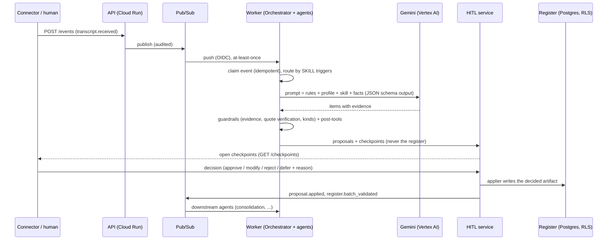

# Architecture

## Event flow

## Components

| Component | Responsibility | Where |
|---|---|---|
| Orchestrator | Routes events to agents by `triggers`, filters by `when_kinds`, keeps depth guard, fans schedule ticks out per tenant/project, sweeps overdue checkpoints, lists open checkpoints. **Does not reason.** | `orchestrator/router.py` |
| AgentRunner | One skill × one event: pre-tools → LLM → guardrails → post-tools → proposals/reports. Idempotent per `(event, agent)`; deterministic proposal ids make redelivery safe. | `agents/runner.py` |
| Skills | `SKILL.md`: YAML frontmatter (triggers, emits, checkpoint, roles, tier, output kinds, tools, context) + instructions. Add an agent by adding a file; `tests/test_skills.py` checks reachability and safety invariants. | `skills/` |
| Tools | Deterministic computation: dependency graphs/waves/critical path/cycles, rubric scoring with frozen weights, readiness and DoD gates, coverage, handoffs, duration variance. | `tools/` |
| HITL service | The only path from proposal to register. Authorisation, reasons, multi-approver rules, deadlines, escalation, batch completion events. | `core/hitl.py` |
| Appliers | Write approved artifacts (requirements, template versions, merges that keep originals visible, flags → workshop requests, cutover task versions with change log, guideline versions). | `core/appliers.py` |
| Audit | Per-tenant hash chain; Postgres trigger forbids UPDATE/DELETE. | `core/repo.py`, `migrations/001_init.sql` |

## Trust boundaries and security

* **Prompt injection**: transcripts, documents and tickets are untrusted. They are fenced as data, the base prompt tells the
  model to ignore instructions inside them, and, more importantly, the model *cannot* act: its only output is a schema-checked
  proposal that a human must approve. Output kinds are whitelisted per agent and human-only kinds (`signoff_received`,
  `scope_frozen`, `estimate_committed`, ...) are rejected for every agent.
* **AuthN/Z**: Cloud Run IAM + Google ID tokens (`AURANEXUS_AUTH_MODE=oidc`). Roles come from the tenant member table, not the
  token. Dev header auth refuses to run unless `AURANEXUS_ENV=local`; `validate_for_runtime()` refuses unsafe prod config.
* **Internal endpoints** accept only allow-listed service accounts (Pub/Sub push SA, Scheduler SA).
* **Tenant isolation**: `tenant_id` everywhere + RLS (`app.tenant_id` set per transaction) + non-owner `NOBYPASSRLS` app role.
* **Data**: Cloud SQL private IP only, TLS enforced, PITR; GCS CMEK with public access prevention; secrets in Secret Manager
  (regional replicas); Pub/Sub persistence restricted to the deployment region. Gemini (or Claude) runs on Vertex AI inside your project; no API keys, only the service account.
* **No public invocation**: there is no `allUsers` binding; the worker is internal-ingress only.

## Failure handling

* Permanent agent failures (bad input, refusal, invalid model JSON, frozen-rubric violation) are recorded as failed runs and
  not retried. Transient ones raise `TransientFailure` → HTTP 503 → Pub/Sub redelivery with backoff → DLQ after 5 attempts.
* Event claim + per-run ids make redelivery idempotent; decided proposals are never overwritten by a re-run.
* Applier failures re-open the checkpoint so the human can retry; nothing half-applied stays "decided".
* Concurrent decisions are serialised with optimistic concurrency (`rev`).

## LLM providers

`core/llm.py` hides the provider behind `LLMClient.generate_json(system, user, schema)`:

| Backend | SDK | Structured output | Notes |
|---|---|---|---|
| `gemini` (default) | `google-genai` with `vertexai=True` | `response_mime_type=application/json` + `response_json_schema` | Schema is sanitised (`additionalProperties` etc. removed); closed-object checking is done by pydantic + guardrails. Safety finish reasons map to a refusal (never retried), `MAX_TOKENS` to a permanent error. `temperature` defaults to 0. |
| `claude` | `anthropic[vertex]` | `output_config.format` json_schema | Optional extra `.[claude]`; `effort` setting applies. |
| `fake` | none | scripted | tests and offline demos |

Everything above the client (prompts, guardrails, HITL, appliers, tools) is provider-independent, so switching is a
configuration change. Item payloads travel as a JSON string (`payload_json`) because structured-output schemas require
closed objects.
